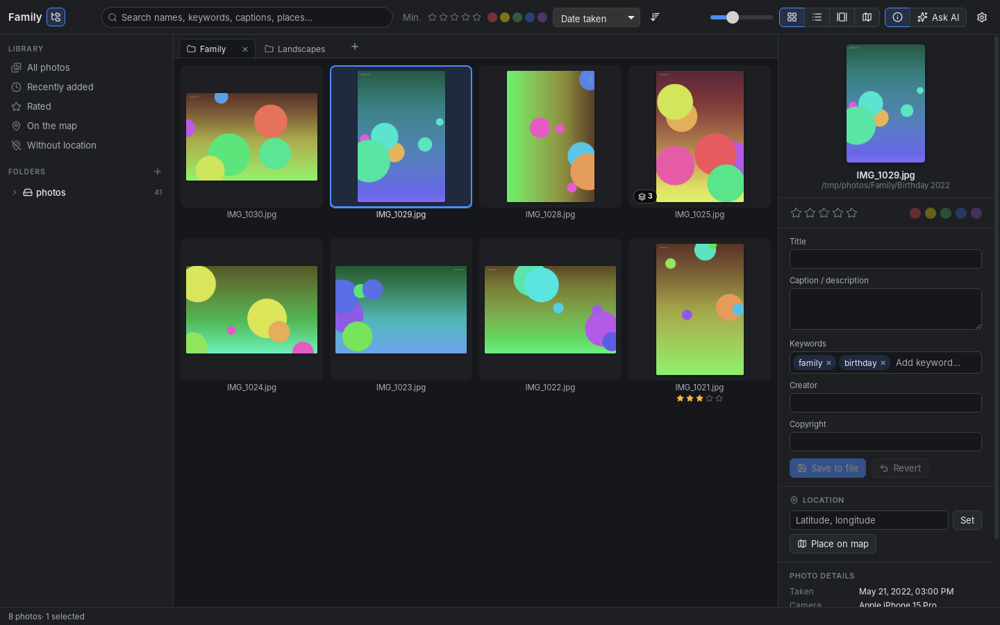

# Lumio by Light and Alley

**A lightweight, open-source photo browser and digital asset manager for macOS, Windows and Linux.**

Lumio is for photographers who want something simple: After trying the bloated Abode and other open-source alternatives like Digikam, I wanted to build something lightweight that does not easily crash.
Adobe Bridge is available for free. However, you are forced to install Creative Cloud software, create an Adobe account, and sign in with it, even if you do not have a subscription, and your data is not secure. Digikam is an excellent program. However, the experience is often frustrating for two reasons. It crashes too often, and indexing a large library like mine (>55,000 photos) can take days, especially if it is on a network drive. 
So I created something simple: browse folders of photos on your computer, external drives, and network drives; rate and tag them; put them on a map; and find them again without importing them into a heavy catalog or editing suite. Lumio doesn't edit pixels. It hands photos to the editor you already use and retrieves the result when you save.
What it does well is organize your library. You can connect your external drives, SD cards, etc., and import photos. Organize your large library, move photos in bulk, create a structure, rate photos, and create photo groups. 
This software is open source and can be used and modified as you wish. It does not collect your data, displays no advertisements, and poses no security risks. Let me know if you encounter any issues. I will try to fix them in my free time. I have a full-time, very different day job. Please also feel free to use and change the software, fix any bugs, and share it so everyone benefits. Please also share feedback and any suggestions for improvement. Please be patient with me; I am just a hobbyist.  
If you would like to work on this project, please connect. If you can also support this, I can get more help and time.




## Features

| | |
|---|---|
| **Browse** | Fast thumbnail grid for very large folders, a folder tree, smart views (recently added, rated, on the map, without location), search by name, keyword, caption, place, camera or lens, and filters for rating and colour label. |
| **Browse** | Open folders in tabs within the application and move files between the tabs. |
| **Offline thumbnails** | Lumio keeps a small catalogue and thumbnail cache on your computer, so folders on unplugged external or network drives can still be browsed. They're shown with a "drive not connected" badge. |
| **Viewer** | Full-screen viewer with zoom and pan and a **black / grey / light grey / white** background switch (press `B`). |
| **Ratings & labels** | 0–5 stars (`0`–`5` keys) and colour labels (`6`–`9`), written into the photo as standard XMP so Lightroom, Bridge, digiKam, Capture One and darktable see them too. |
| **Rotate & flip** | Rotate left or right (`⌘[` / `⌘]`, `Ctrl+[` / `Ctrl+]`) and flip horizontally or vertically, from the right-click menu, the filmstrip or the viewer. Lossless: only the orientation tag changes (in an XMP sidecar for RAW files), so the image itself is never re-saved. |
| **Groups (stacks)** | Select shots of the same subject and press `⌘G` / `Ctrl+G` to group them. A closed group shows one cover photo with a count; click the count or press `S` to open it. Make any shot the cover, take shots out, or ungroup with `⇧⌘G` / `Ctrl+Shift+G`. Groups move together. They're kept in Lumio's catalogue, not written into the files. |
| **Metadata editing** | Title, caption, keywords, creator and copyright, for one photo or many at once. Saved into the file (EXIF/IPTC/XMP) or, for RAW files, into an XMP sidecar by default. |
| **Geotagging** | Map view (OpenStreetMap). Drag photos onto the map, or select photos and click a spot. Place search, clustering, and GPS written into the files. |
| **File management** | Drag photos or folders onto a folder to move them (hold `Alt`/`⌥` to copy), or use Move to… / Copy to… for any destination, including other drives and network shares. Cross-drive moves are copied and verified before the original is removed. New folder, rename, and Move to Trash (sidecars travel with their photos). |
| **Open with…** | Right-click a photo to see every app the operating system says can open it (Photoshop, Affinity, GIMP, Preview, Photos…). |
| **Picks up edits** | Lumio watches your library folders. When an editor saves or exports a file there, the thumbnail and metadata refresh and new files appear automatically. |
| **AI photo finder** | "Show me sunsets from last summer rated 4 stars or more." Ask in plain language and the assistant searches the catalogue (dates, places, keywords, ratings, cameras) and can look at thumbnails for visual questions. Works with **Claude** (your own Anthropic API key) or a **local model** through Ollama / LM Studio, so nothing leaves your computer. |

Supported formats: JPEG, PNG, WebP, GIF, BMP, TIFF, HEIC/HEIF, AVIF, and RAW (DNG, CR2, CR3, NEF, ARW, RAF, ORF, RW2, PEF, SRW and more).

## Installing

Download the installer for your system from the **Releases** page:

- **macOS**: `Lumio_x.y.z_aarch64.dmg` (Apple Silicon) or `_x64.dmg` (Intel). Open the .dmg and drag Lumio to Applications.
- **Windows 11**: `Lumio_x.y.z_x64-setup.exe` or `.msi`.
- **Linux**: `.AppImage` (any distro), `.deb` (Ubuntu/Debian) or `.rpm` (Fedora).

The builds are not code-signed yet, so the first launch shows a warning:

- **macOS**: right-click Lumio in Applications, choose **Open**, then **Open** again. If macOS says the app "is damaged", run `xattr -cr /Applications/Lumio.app` in Terminal once.
- **Windows**: on the SmartScreen prompt, click **More info**, then **Run anyway**.

## Using the AI finder

Open **Settings → AI assistant**:

- **Claude**: paste an API key from [console.anthropic.com](https://console.anthropic.com). It's stored in your system keychain. Usage is billed by Anthropic; a search typically costs a fraction of a cent at the default "low" effort.
- **Local model**: install [Ollama](https://ollama.com), run `ollama pull llama3.1`, and choose "Local or OpenAI-compatible model" (default address `http://localhost:11434/v1`).

By default the assistant sees only catalogue text: file and folder names, dates, places, keywords, captions and camera details. It sees small thumbnails only when you leave "Let the assistant look at thumbnails" switched on.

## Where Lumio keeps its data

Your photos are never moved or changed unless you ask. Lumio's own catalogue (`catalogue.sqlite`) and thumbnails live in:

- macOS: `~/Library/Application Support/app.lumio.photos/`
- Windows: `%APPDATA%\app.lumio.photos\`
- Linux: `~/.local/share/app.lumio.photos/`

If a network or cloud drive (SMB, pCloud, Dropbox…) stops answering while Lumio is indexing it, for example because the computer went to sleep, Lumio pauses and carries on when the drive is back, instead of cataloguing empty entries. Problems are written to `lumio.log` in the same folder.

Deleting that folder resets Lumio. Your photos and the metadata written into them stay.

## Building from source

Requirements: [Rust](https://rustup.rs) (stable), [Node.js](https://nodejs.org) 20+, and the [Tauri prerequisites](https://v2.tauri.app/start/prerequisites/) for your OS (Xcode Command Line Tools on macOS; WebView2 and the MSVC build tools on Windows; `libwebkit2gtk-4.1-dev` and friends on Linux).

```bash
npm install
npm run fetch-exiftool   # downloads ExifTool into src-tauri/resources/exiftool
npm run app              # run in development mode
npm run dist             # build an installer for this computer (src-tauri/target/release/bundle/)
```

To build installers for all three systems at once, push the repository to GitHub and run the **Build installers** workflow (`.github/workflows/release.yml`) from the Actions tab. It produces a draft release with every installer attached.

## How it's built

- **Rust** back end ([Tauri 2](https://tauri.app)) using the system's own web view, so the app stays small (about 15 MB installed versus hundreds of MB for Qt or Electron apps).
  - `src-tauri/src/db.rs`: SQLite catalogue
  - `indexer.rs`: background scanning, metadata reading and thumbnail building
  - `thumbs.rs`: thumbnails and previews (the `image` crate, embedded RAW previews, `sips` for HEIC on macOS)
  - `exiftool.rs` / `metadata.rs`: metadata reading and writing via a persistent ExifTool process
  - `fileops.rs`: move, copy, rename and trash, keeping the catalogue in sync
  - `watcher.rs`: file-system watching for edits made in other apps
  - `openwith.rs`: "Open with" on macOS (Launch Services), Windows (Shell association handlers) and Linux (.desktop files)
  - `ai.rs`: the AI finder (Claude Messages API with tool use, or any OpenAI-compatible server)
- **Svelte 5 + TypeScript** front end in `src/`, with [Leaflet](https://leafletjs.com) for maps and [Lucide](https://lucide.dev) icons.

## Contributing

Issues and pull requests are welcome. Please keep Lumio light: no pixel editing, no heavy dependencies, and every change that touches files should be safe on external and network drives.

## Credits & licence - © Light and Alley

Lumio is MIT licensed (see `LICENSE`). It bundles [ExifTool](https://exiftool.org) by Phil Harvey (Perl Artistic Licence / GPL). Map data © [OpenStreetMap](https://www.openstreetmap.org/copyright) contributors. Feature ideas were inspired by digiKam and Adobe Bridge; Lumio shares no code or design with them.
